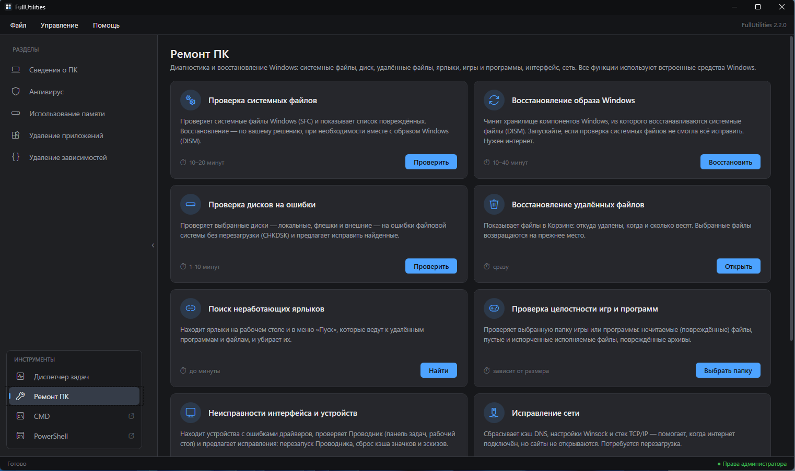
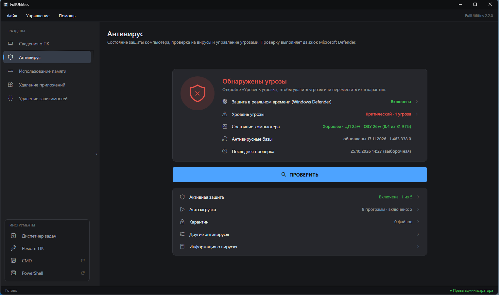
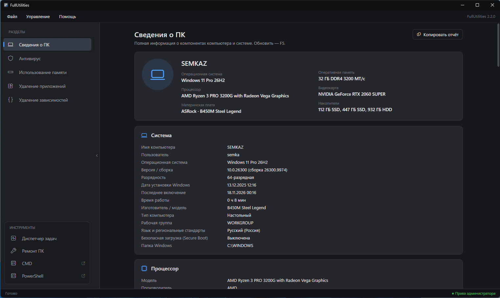

**Актуальная версия: 2.2.0**

[⬇️ Скачать последнюю версию FullUtilities](https://github.com/semka007129-usex/FullUtilities/releases/latest)

**Новые версии и обновления программы публикуются на странице** [GitHub Releases](https://github.com/semka007129-usex/FullUtilities/releases).

**FullUtilities распространяется на условиях авторской лицензии. Ознакомиться с полными условиями можно в файле** [LICENSE.txt](LICENSE.txt).

## 🧰 FullUtilities

**Всё для ухода за компьютером — в одной программе.**

**FullUtilities** — многофункциональная утилита для Windows: сведения о компьютере, антивирус, анализ занятого места, удаление программ и их остатков, диспетчер задач и ремонт системы. Вместо десятка разных программ и спрятанных настроек Windows — одно понятное окно. Она подойдёт и обычному пользователю, и тому, кто привык сам следить за своим ПК.

*Программа полностью бесплатна и в дальнейшем платной не будет. Автор хочет, чтобы у каждого был простой и надёжный инструмент для ухода за компьютером!*

## ✨ Почему FullUtilities

• **Сведения о ПК.** Система, процессор, материнская плата и BIOS, каждый модуль памяти, видеокарты, мониторы, накопители с состоянием и температурой, сеть, звук, батарея. Отчёт копируется одной кнопкой.

• **Антивирус.** Быстрая, полная и выборочная проверка движком Microsoft Defender, окно угроз, зашифрованный карантин, контроль автозагрузки и справочник о вирусах простыми словами.

• **Активная защита.** Работает в фоне со значком в трее: проверяет загрузки браузера, флешки и внешние диски, следит за угрозами и проверяет компьютер по расписанию.

• **Использование памяти.** Карта занятого места на любом диске, включая флешки: сразу видно, какие папки и файлы занимают больше всего, и лишнее можно удалить.

• **Удаление приложений и их остатков.** Программа удаляется штатным деинсталлятором, а затем FullUtilities находит и убирает то, что от неё осталось.

• **Удаление зависимостей.** Python и пакеты pip, .NET, NuGet, Java, Node.js и npm, Visual C++ Redistributable — в одном списке.

• **Диспетчер задач.** Процессы, графики производительности, автозагрузка, службы и приостановка программы до конца сеанса с освобождением памяти.

• **Ремонт ПК.** Проверка системных файлов и образа Windows, проверка дисков, восстановление из Корзины, поиск неработающих ярлыков, проверка целостности игр, исправление сети и очистка временных файлов — встроенными средствами Windows, в пару кликов.

• **Удобный интерфейс.** Тёмная и светлая темы, русский и английский языки, поиск по разделу, CMD и PowerShell с правами администратора под рукой.

• **Ваши данные остаются у вас.** Программа работает локально и ничего никуда не отправляет.

## 💻 Установка

• Скачайте установщик (или архив с ним) и запустите его.

• Выберите язык, папку и ярлыки, примите лицензионное соглашение и нажмите «Установить».

• Запустите FullUtilities с рабочего стола или из меню «Пуск».

**Требования:** Windows 10 или 11 (64-бит). Всё необходимое, включая .NET, уже внутри — дополнительные загрузки не нужны. Программа запрашивает права администратора: без них нельзя удалять программы, проверять системные файлы и диски.

Если Windows покажет окно «Windows защитила ваш компьютер», нажмите «Подробнее» → «Выполнить в любом случае». Так система реагирует на новые программы без платной цифровой подписи.

Чтобы обновить программу, просто запустите новый установщик поверх старой версии — настройки сохранятся.

*На Linux и других системах программа не проверялась!*

## 🛠️ Разработка и авторство

**FullUtilities** — независимый авторский проект, разрабатываемый **Semka Z**.

В процессе разработки используется **Claude Code** в качестве AI-инструмента для написания, анализа и улучшения программного кода.

**Концепция, постановка задач, проверка результатов, тестирование и развитие проекта осуществляются автором.**

## 🔄 Что дальше

**FullUtilities развивается.** В программу будут регулярно добавляться новые инструменты и возможности, так что заходите сюда за обновлениями.

Если вы заметите ошибки при работе с программой, сообщите пожалуйста о них автору программы.

## 📬 Связь

**Автор/разработчик:** Semka Z. **Telegram:** @mrsemkaz · **Discord:** mrsemkaz · **Почта:** semka007129@gmail.com

## ❤️ Поддержать разработчика

Если вам нравится FullUtilities, вы можете поддержать его развитие:

[Поддержать FullUtilities на Boosty](https://boosty.to/mrsemkaz/donate)

[Поддержать разработчика напрямую](https://pay.cloudtips.ru/p/22fc577e)
